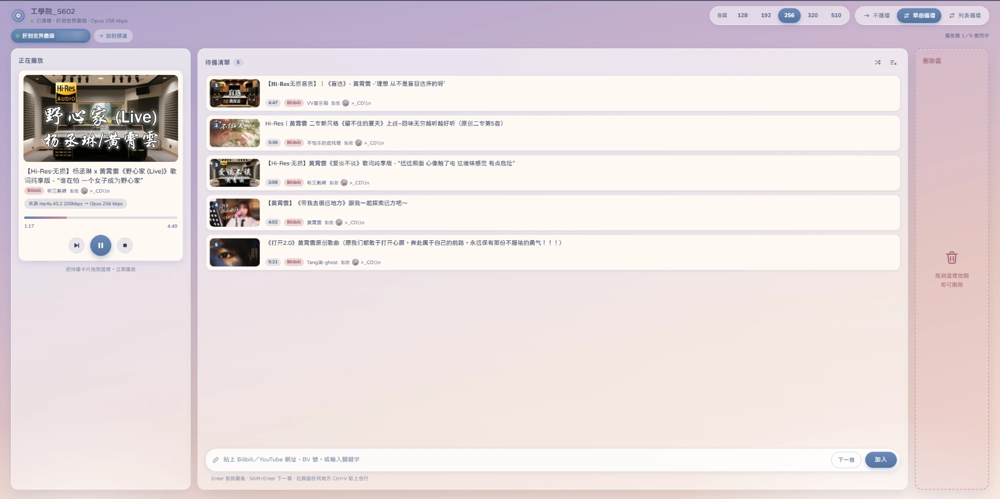
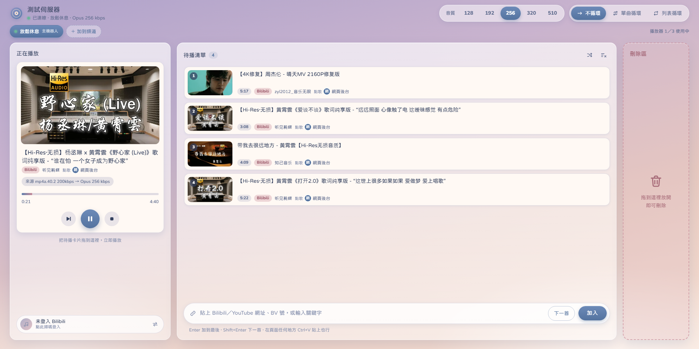

# 本地 Discord MP3 bot（Bilibili 優先）＋ 網頁看板

## 首先感謝 claude code sonnet 5.5 協作<br>沒 ai agents 一個晚上我真的做不出來 哈哈

本地執行，完全 free 高音質 Discord MP3 bot<br>
yt-dlp 取最高品質音軌 給 ffmpeg 轉成 Opus 再給 Discord；另附 trello 風格的網頁看板，看板同頻道的朋友也可以用哦(需要用到 VPS )


<sub>中控台實際使用的畫面（個人資訊已模糊處理）/ the dashboard in real use (personal info blurred)</sub>


<sub>用測試用的假資料截圖，可以自己跑 `tests/harness_hub.py` 重現 / screenshot with demo data, reproducible with `tests/harness_hub.py`</sub>

## English summary

A free Discord music bot that runs on your own PC. It resolves the best audio track with **yt-dlp**, re-encodes
it to **Opus** with **ffmpeg** and streams it to a Discord voice channel. It is Bilibili-first (paste a URL, a BV id
or just keywords; YouTube and other yt-dlp sites work too) and ships a Trello-style **web dashboard** to manage the
queue with drag-and-drop cards.

- **Multi-channel playback**: a Discord bot account can sit in only one voice channel per server, so extra
  channels are served by *clone* bot accounts (`add-clone.bat`). A background **stutter detector** keeps playback
  smooth: if it is certain a newly added channel is causing stutter, it stops channels one at a time, newest first.
- **Dashboard access**: the personal link from `/help` is the only way in (`verify`, device remembered) or
  `voice` (link + you must be in a voice channel); there is no "anyone with the URL" mode since 2.0. Optional **relay** node on a VPS so friends can reach the
  dashboard while the music keeps playing at home (no router ports needed).
- **My playlists** (2.0): each Discord user's own folders and playlists of links, nested folders, multi-select, loop a folder or loop across folders, Spotify account link (reads your own Spotify playlists). Stored in `library.json` on the machine that runs the bot.
- **Quality**: an Opus source (YouTube) goes into Discord untouched; Bilibili's AAC is re-encoded once with quality-first settings (no assumed packet loss, soxr resampling); Spotify songs are matched to the best-quality video of the right length.
- **Big queues**: the dashboard draws only the cards in view, so a 2500-card queue scrolls and drags at 60 fps.
- **Quick start**: create a bot in the Discord Developer Portal, install Python 3.11+ and ffmpeg, run
  `python -m venv .venv`, `.venv\Scripts\python.exe -m pip install -r requirements.txt`, copy `.env.example` to
  `.env`, put your token in it, then double-click `start.bat`. The rest of this README is in Traditional Chinese;
  every source file carries bilingual (中文 / English) comments to help contributors.
- **For developers**: guides on adding a language, changing colors, tuning the audio path and reusing the UI are in
  [docs/DEVELOPING.en.md](docs/DEVELOPING.en.md) (English) and [docs/DEVELOPING.zh-TW.md](docs/DEVELOPING.zh-TW.md) (繁體中文);
  tests are in [tests/](tests/). Current version: **v1.0.0** ([CHANGELOG](CHANGELOG.md)).
- **Never commit** `.env`, `cookies.txt`, `settings.json` or `members.json` — they hold secrets (already in `.gitignore`).

以下為完整說明（繁體中文）

## 特色

- **Bilibili 優先**：貼網址、BV 號、整段分享文字都能"自動辨識"；同時支援 YouTube 等 yt-dlp 能解析的網站
- **Spotify 連結**：單曲、專輯、播放清單都能貼，會去 Bilibili（找不到換 YouTube）找對應的歌來播，不是 Spotify 本身的音源
- **清單上限**：合集一次最多 5000 首，一個伺服器的待播清單最多 5000 首（`MAX_QUEUE` 可改）
- **多語言看板**：右上角選單切換，預設繁體中文（繁中、簡中、English、日本語）
- **音質**：auto 最高品質音軌；Opus 位元率預設 192、max 510（控制看板自由切換）
- **網頁看板**：拖曳排序、切歌、刪除，能拖曳進度條，單曲／列表循環
- **多人共用看板**：伺服器內使用者皆可控制所有頻道（可改成"連結＋人在語音頻道才能控制"的語音模式）
- **分身**：同伺服器多頻道同時播放，加機器人帳號就行，相同音質(卡頓自動刪減機器人並公告)
- **無損音源**：看板上掃 QR 碼登入 Bilibili 大會員帳號

## 快速開始

1. 到 [Discord Developer Portal](https://discord.com/developers/applications) 建立應用程式 → Bot → 複製 Token，並用 OAuth2 邀請連結（scopes：`bot`、`applications.commands`；權限：View Channel、Send Messages、Embed Links、Connect、Speak）把機器人加入伺服器
2. 安裝需求：Python 3.11+、[ffmpeg](https://ffmpeg.org/download.html)
3. 建立虛擬環境並安裝套件
   ```bash
   python -m venv .venv
   .venv\Scripts\python.exe -m pip install -r requirements.txt
   ```
4. 把 `.env.example` 複製成 `.env`，填入 `DISCORD_TOKEN`
5. 雙擊 `start.bat`（或 `.venv\Scripts\python.exe bot.py`），看到"已登入"與"網頁後台已啟動"就完成了
6. 進語音頻道，輸入 `/play "歌曲連結"`，再輸入 `/help` 取得看板連結

## 在 Discord 使用

| 指令 | 說明 |
| --- | --- |
| `/help` | 說明，並給你**專屬**的看板連結（只有你看得到） |
| `/play 內容 [when]` | 貼網址、BV 號或關鍵字，`when`：加到最後（預設）／下一首播放／立刻播放 |
| `/join` | 讓機器人進入你的語音頻道 |
| `/skip` `/pause` `/resume` `/stop` `/loop` | 控制你所在頻道的播放器 |
| `/queue` `/nowplaying` | 看清單；看目前曲目與實際音質 |
| `/quality` | 設定這個伺服器的音質 |
| `/players` | 看所有播放器（含分身）的狀態，以及分身的邀請連結 |
| 對訊息按右鍵 → 應用程式 → **加入播放佇列** | 朋友貼了連結，一鍵加歌 |

預設不打擾頻道裡的其他人：指令的回覆只有你自己看得到，機器人只在出問題時才在頻道發訊息
想讓大家都看得到，在 `.env` 設 `PUBLIC_REPLIES=1`；想要每首歌都發"正在播放"，設 `CHANNEL_NOTICES=all`（完全不發是 `off`）

### 我的歌單與 Spotify（2.0）

看板待播清單標題右邊的 **資料夾圖示** 是"我的歌單"，旁邊的 **選取圖示** 可以勾選待播的歌
- **存成歌單**：按選取、點幾張卡片、按"存成歌單"；或按卡片右上角的"加入歌單"把一首歌放進某張歌單
- **資料夾**：在歌單視窗按"選取"、勾幾張歌單，按"建立資料夾"；資料夾裡還可以再建資料夾（最多 8 層）
- **播放**：卡片上的 ▶ 可以"加到最後／取代待播／放到下一首"；資料夾還有 **資料夾循環**（播完重播這個資料夾）和 **跨資料夾循環**（播完換同一層的下一個資料夾，到底繞回第一個）
- **拖曳**：視窗左邊的資料夾列（像檔案總管）點一下就跳過去；卡片可以拖來排序，拖到左邊的資料夾或上方路徑就搬進去，拖到右上角出現的 **刪除區** 就刪除；歌單裡的歌曲同樣能排序、拖到另一張歌單、拖去刪除
- **貼連結存入**：貼 Bilibili／YouTube／Spotify 的歌曲或歌單連結，直接存起來，下次召喚機器人不用再貼
- 每個人只看得到自己的歌單（用 Discord 身分區分），存在執行機器人的這台電腦的 `library.json`，不會傳到中繼站
- **Spotify 帳號**（選用）：到 Spotify 開發者後台建立應用程式並登記 Redirect URI 後，把 Client ID 貼進看板的"Spotify 帳號"視窗（擁有者才看得到輸入欄；也可以填 `.env` 的 `SPOTIFY_CLIENT_ID`），就能直接在看板登入；連結後歌單視窗多一個"我的 Spotify 歌單"，點一張就存進我的歌單
  Spotify 限制：開發模式的應用程式要擁有者有 **Premium**、最多 **5** 位使用者，而且只讀得到**自己建立或共同編輯**的歌單（Spotify 沒有提供歌單資料夾）；**這部分尚未用真的 Premium 帳號驗證**

### 輸入的自動辨識

| 你貼的內容 | 結果 |
| --- | --- |
| 含有網址的文字（包含 Bilibili App 分享出來的"標題＋網址"） | 直接使用該網址 |
| `BV1xxxxxxxxx` 或 `av123456` | Bilibili 影片 |
| `yt:關鍵字` | YouTube 搜尋 |
| Spotify 連結（`open.spotify.com/track／album／playlist/…`、`spotify:track:…`） | 讀歌名和歌手，去 Bilibili／YouTube 找對應的歌 |
| 其他文字 | Bilibili 關鍵字搜尋 |

Spotify 的限制：連結要是公開的；播放清單最多讀到 100 首（Spotify 公開頁面只給這麼多）；對應的歌可能是翻唱或別的版本，Discord 會顯示"對應影片"讓你確認

## 網頁看板

在 Discord 輸入 `/help` 取得連結，從執行機器人的這台電腦直接開 `http://localhost:8765` 也可以（視為主人，不需要連結）

| 操作 | 方式 |
| --- | --- |
| 加歌 | 清單下方輸入框貼上內容：**Enter** 加到最後、**Shift+Enter**（或"下一首"按鈕）插到最前面 |
| 更快的加歌方式 | 在頁面任何地方 **Ctrl+V** 直接貼上；或把瀏覽器裡的連結拖進頁面 |
| 調整順序 | 拖曳卡片（封面上的數字就是播放順序） |
| 刪除 | 拖到右側刪除區放開，或卡片右上角的 ✕ |
| 刪除正在播放的 | 把"正在播放"卡片拖進刪除區（跳到下一首，且不會被循環排回去） |
| 立即播放 | 把待播卡片拖到左側"正在播放"，或按卡片上的 ▶ |
| 調整進度 | 點進度條或按住拖曳（會顯示目標時間）；鍵盤左右鍵 ±5 秒 |
| 循環／音質 | 右上角：不循環／單曲／列表；音質 128／192／256／320／510 |

### 誰能做什麼（`DASHBOARD_ACCESS`）

**入口只有一個：`/help` 給的專屬連結**（2.0 起沒有"知道網址就能用"的開放模式）。在 Discord 輸入 `/help`，點它給你的連結，點一下就綁定你的 Discord 身分，之後可以控制這個伺服器**所有頻道**的播放

| | 看 | 控制播放（所有頻道） | 更換 Bilibili 帳號 |
| --- | --- | --- | --- |
| 執行機器人的電腦上直接開 localhost | 是 | 是 | **是** |
| 機器人擁有者（用 `/help` 給的擁有者連結） | 是 | 是 | **是** |
| 其他成員（用自己的 `/help` 連結） | 是 | 是 | **否** |
| 只知道網址、沒有連結的人 | 否（只會看到"請用 /help 的專屬連結進來"） | 否 | 否 |

- 在看板上用"**＋ 加到頻道**"選一個語音頻道，會開出該頻道**獨立的分頁**（派一個閒置的機器人進去，歌只進這個頻道）；已經有播放器的頻道，直接點上方分頁就能控制它，見下面"分身"
- 看板上"點歌：xxx"顯示的是你真實的 Discord 暱稱和頭像
- **更換 Bilibili 帳號永遠只限擁有者／本地**，因為那會換掉你電腦上登入的帳號
- `.env` 的 `DASHBOARD_ACCESS` 可以是 `verify`（預設）或 `voice`（連結 + 人要在語音頻道裡才能控制）；舊 `.env` 還寫 `open` 會自動當成 `verify`並在記錄裡提醒

**驗證模式（`verify`）**：用 Discord 證明"你是這個伺服器的成員"，朋友**不需要安裝任何東西、也不用輸入任何碼**

1. 朋友在 Discord 輸入 `/help`，機器人**只回給他本人看**一個專屬連結
2. 點一下連結：看板立刻是完整畫面，**顯示他真實的 Discord 暱稱**，可以控制所有頻道；"點歌：xxx"也是這個暱稱
3. 這個瀏覽器會被**主機記住**，下次直接開網址就能進，不用再點連結；機器人重啟也不會消失
4. 沒有連結的人只會看到"請從 Discord 的專屬連結進來"，什麼都看不到、什麼都不能做

- **換新裝置**：在那個裝置的 Discord 輸入 `/help`，再點一次連結就好
- **記憶存在執行機器人的那台電腦**（`members.json`，已列入 `.gitignore`），**不存在中繼站**，瀏覽器裡存的是一把隨機長憑證，主機只存它的雜湊，檔案外流也無法冒用
- **只有伺服器成員進得來**：只有在伺服器裡才能用 `/help` 拿到連結；已經退出伺服器的人，裝置憑證會自動失效
- **撤銷**：`/unverify` 撤銷你自己記住的裝置；擁有者可以 `/unverify user:@某人` 撤銷別人，被撤銷的人正在開的看板會立刻回到"請用連結進來"，尚未過期（12 小時）的連結本身不會被撤銷，過期後才失效
- 沒有 IP 比對：Discord 不會把使用者的 IP 給機器人，所以不可能比對；身分完全靠專屬連結（簽章綁定 Discord 身分）
- **注意**：專屬連結等同於你的身分，**不要轉貼給別人**，朋友自己輸入 `/help` 就有他的
- 驗證模式下 `/api/guilds` 與 `/` 的伺服器清單不公開，朋友要用 `/help` 給的連結進來

**語音模式**：每個人用自己的 `/help` 連結進來（簽章、綁定他的 Discord 身分、12 小時有效、請勿轉貼），而且**人要在語音頻道裡才能控制**，不在頻道的人唯讀，離開頻道立刻失去控制權；沒有有效連結的人完全進不來（包含經過通道轉進來的請求，後端會辨識代理標頭，不會把它們當成本地）

### 讓朋友一起用

預設只開放本地（`127.0.0.1`），朋友打不開，要讓朋友連進來，需要一個**雙方都連得到的網路**，選一個：

| 方式 | 朋友要做什麼 | 適合 | 備註 |
| --- | --- | --- | --- |
| **Radmin VPN** | 安裝 Radmin VPN，輸入你給的"網路名稱＋密碼" | 朋友都用 Windows，想最簡單 | 免帳號；位址通常是 `26.x.x.x` |
| **Tailscale** | 安裝並登入（Google／Microsoft 帳號），你邀請他加入你的網路 | 有手機／Mac／Linux，要穩定 | 位址是 `100.x.x.x`；個人使用免費（額度以官方為準） |
| **ZeroTier** | 安裝後輸入你的"網路 ID"，你在後台核准他 | 想要自己掌控、跨平台 | 位址依你的設定 |
| **同一個區網** | 什麼都不用裝 | 同一個 Wi-Fi／宿舍網路 | 不同網路就連不到 |
| **Cloudflare 通道** | **什麼都不用裝**，只要點網址 | 朋友不想裝東西 | 網址是**公開**的 → 請搭配 `DASHBOARD_ACCESS=voice`（見上） |

虛擬網路（前四種）是你和朋友裝同一個軟體、加入同一個虛擬網路，彼此會拿到一個"虛擬 IP"，就像在同一個區網，流量有加密，只有網路成員連得到你的看板

**設定步驟（虛擬網路／區網）**
1. 你和朋友都加入同一個虛擬網路，確認互相 ping 得通
2. `.env` 設 `DASHBOARD_HOST=0.0.0.0`，重啟機器人
3. 機器人啟動時會**自動偵測並列出朋友可嘗試的網址**（虛擬網路優先），例如：
   ```
   網頁後台已啟動：http://26.12.34.56:8765
     朋友可嘗試的網址：http://26.12.34.56:8765（Radmin VPN）
   ```
   `/help` 給出的連結也會自動用這個位址，想手動指定就設 `DASHBOARD_URL=http://你的虛擬IP:8765`
4. 把 `/help` 給的網址貼給朋友，如果打不開，多半是 Windows 防火牆擋住，用**系統管理員** PowerShell 允許該連接埠：
   ```powershell
   New-NetFirewallRule -DisplayName "音樂機器人看板" -Direction Inbound -Protocol TCP -LocalPort 8765 -Action Allow -Profile Any
   ```

> 流量走虛擬網路時是加密的；走一般區網的 `http://` 則不加密（家裡或宿舍通常可以接受），**不要**直接把電腦的公網 IP 開給別人：連線沒有加密，而且多半被防火牆擋住，所以程式不會自動採用公網 IP

**Cloudflare 通道（朋友什麼都不用裝）**：用 [Cloudflare Quick Tunnel](https://developers.cloudflare.com/cloudflare-one/connections/connect-networks/do-more-with-tunnels/trycloudflare/)（免費、免帳號）把本地連接埠暴露出去：
```bash
cloudflared tunnel --url http://localhost:8765
```
取得 `https://xxxx.trycloudflare.com` 後設成 `DASHBOARD_URL`，並設 `DASHBOARD_ACCESS=voice`，重啟機器人

## 中繼站：看板放在 VPS／樹莓派，放歌留在家裡

家裡的電腦在路由器後面，朋友連不進來；但放歌必須留在家裡（住宅 IP 才能正常搜尋 Bilibili／YouTube，也不需要買好的主機）
解法是讓家裡的機器人**主動連出去**到一個有公網位址的"中繼站"，朋友的瀏覽器只連中繼站：

```
朋友的瀏覽器 ──▶ 中繼站（VPS／樹莓派）◀── 家裡的機器人（主動連出，不用開任何埠）
                  只轉送訊息                  放歌、解析、權限判斷、Bilibili 登入
```

**中繼站很輕量**：只需要 Python 3.9+ 和 `aiohttp`，**不需要 discord.py、yt-dlp、ffmpeg**，也不需要好的 CPU，樹莓派或最便宜的 VPS 就夠

**設定**
1. **中繼站**（VPS／樹莓派）：取得專案（只有 `musicbot/` 與 `web/` 會用到）→ `pip install -r requirements-relay.txt` → 在 `.env` 寫 `RELAY_KEY=（隨機字串）` → 執行 `python -m musicbot.relay`（`start-relay.sh`），要開機自動啟動可用 [`deploy/discord-musicbot-relay.service`](deploy/discord-musicbot-relay.service)，記得放行 `RELAY_PORT`（預設 8765），並看下面的"放上公網前的檢查表"
2. **家裡**：`.env` 加上 `RELAY_URL=ws://中繼站位址:8765` 與**同一把** `RELAY_KEY`，重啟機器人，看到"已連上中繼站"就完成了
3. `/help` 給出的網址會自動變成中繼站的網址，貼給朋友就能用

家裡的機器人關機或斷線時，朋友的看板會顯示"播放端離線"（連線不會被關掉），機器人回來後**自動恢復**，不用重新整理

**安全模型**
- 中繼站**只轉送訊息**：不保存任何資料、看不懂也不判斷權限；所有權限（誰能控制、誰是擁有者）都在家裡的機器人那邊判斷
- 家裡的機器人用**挑戰—回應（HMAC）**向中繼站證明身分，**`RELAY_KEY` 本身不會在網路上傳送**；金鑰錯誤的連線會被拒絕，且不會擠掉真正的播放端
- 經過中繼站的連線**永遠不會被當成"本地主人"**，即使它是從中繼站所在的電腦連過來的，更換 Bilibili 帳號只能用擁有者的 `/help` 連結
- 中繼站對每個瀏覽器限流（超量的訊息直接丟棄，不會灌爆家裡的機器人），並限制同時連線數
- **來源 IP 限制**：同一個 IP 同時最多 12 個瀏覽器連線、每分鐘最多 40 次新連線（超過回 429）；同一個 IP 同時最多 3 個尚未完成握手的播放端連線；播放端握手失敗 5 次，該 IP 封鎖 10 分鐘，只有"直接連到中繼站的是本地（例如 cloudflared、Caddy）"時才採信 `CF-Connecting-IP`／`X-Forwarded-For`，從網際網路直連的人無法用標頭偽造自己的 IP
- **HTTP 安全標頭**（看板與中繼站都有）：內容安全政策（CSP，只執行自己的腳本、不能被別的網站用 iframe 嵌入）、`X-Content-Type-Options: nosniff`、`Referrer-Policy: no-referrer`、`Cache-Control: no-store` 等
- **要注意**：沒有網域時中繼站是明文 HTTP，看板上的訊息（含 `/help` 連結裡的憑證）在網路上沒有加密，要加密請在中繼站前面放 TLS（例如 Caddy／Cloudflare 通道，網址改用 `wss://`），或把中繼站放在 Tailscale 等虛擬網路裡
- 2.0 起沒有"知道網址就能控制"的模式，放在公網上也只有拿到 `/help` 專屬連結的人能控制（朋友點一次，之後免輸入）；要更嚴格可以在家裡的 `.env` 設 `DASHBOARD_ACCESS=voice`

**把中繼站放上公網前的檢查表**（Ubuntu／Debian VPS）
- 用**專用的非 root 帳號**跑中繼站（範例 `musicbot`），`.env` 設 `chmod 600`
- 使用 [`deploy/discord-musicbot-relay.service`](deploy/discord-musicbot-relay.service)：已加上沙盒（無特權、只能寫自己的資料夾、只允許網路連線、限制系統呼叫與記憶體／行程數），`systemd-analyze security discord-musicbot-relay` 評分約 1.3（OK）
- 防火牆只放行需要的埠：`ufw allow 22/tcp`、`ufw allow 8765/tcp`，其餘預設拒絕（`ufw default deny incoming`）
- SSH 只用金鑰登入（`PasswordAuthentication no`），並裝 `fail2ban` 擋暴力嘗試
- 開啟自動安全更新（`unattended-upgrades`）
- `RELAY_KEY` 用 `python -c "import secrets; print(secrets.token_hex(32))"` 產生，不要重複使用別處的密碼

**限制**：同一時間只支援一個播放端（家裡的機器人）；中繼站需要朋友連得到（公網 IP，或在同一個虛擬網路內）

## 分身：同一個伺服器多個頻道同時播放

**為什麼需要分身**：Discord 規定，同一個機器人帳號在同一個伺服器同時只能待在**一個**語音頻道，要在多個頻道同時播放，就需要多個機器人帳號，每個分身各自獨立播放

**程式這邊沒有數量限制，但每個分身都要有自己的機器人帳號**——帳號只能由你在 Discord Developer Portal 建立，程式無法代替你產生（Discord 的規定），所以"只有一個 Token"時，整個伺服器就只會有一個機器人，同一時間只能待在一個語音頻道

**設定**
1. 再建立幾個機器人應用程式（[Developer Portal](https://discord.com/developers/applications) → New Application → Bot → Reset Token 複製 Token）
2. 把 Token 交給程式：執行 **`add-clone.bat`**（Linux／macOS：`python -m musicbot.addclone`），貼上 Token（輸入時不會顯示），它會向 Discord 確認 Token 有效、自動寫進 `.env` 的下一個 `DISCORD_TOKEN_n`，並印出這個分身的**邀請連結**，想手動填也行：`DISCORD_TOKEN_2=…`、`DISCORD_TOKEN_3=…`（**數量沒有上限**，有幾個填幾個）
3. 用邀請連結把分身加進伺服器（分身只需要 `bot` scope），重啟機器人，輸入 `/players` 可以看到每個分身的狀態與邀請連結
4. 完成，哪個頻道的人 `/play`，就由閒置的機器人進去；同一個頻道的人共用同一個播放器

**在看板上：每個頻道是一個獨立的分頁**
- 點"**＋ 加到頻道**"選一個語音頻道，會立刻開出一個**獨立的空分頁**（虛線框，標示"尚未播放"），在這個分頁貼網址加歌，歌**只會進這個頻道**，機器人也只會進這個頻道，**完全不影響其他頻道**
- 空分頁上只能加歌；暫停、跳過、循環、清空等操作會被擋下，避免誤動到別的頻道，第一首歌加進去、分身進頻道後，它就變成正式分頁，不想用了可以按分頁上的 ×
- 要控制某個頻道，點它的分頁；每個分頁只管自己的待播清單與播放

**會犧牲音質嗎？不會**，每個分身各自跑獨立的 ffmpeg 與 Opus 編碼，位元率與單獨使用時完全一樣，不會因為分身多而降低，真正的限制是下面三個，撐不住時的症狀是"斷續／爆音"，而不是變糊：

| 限制 | 說明 |
| --- | --- |
| 機器人帳號 | Discord 的規定，每個分身要自己的帳號與 Token（作者無法繞過） |
| CPU | 實測每條串流約佔**單核 3～4%**（Opus 510 kbps 最壞情況） |
| 上傳頻寬 | 約為 串流數 × 位元率；例如 8 條 × 192 kbps ≈ 1.5 Mbps，8 條 × 510 kbps ≈ 4 Mbps |

**實測上限**（6 核／12 執行緒的 Windows 電腦，每條串流都是 510 kbps、含加密與 20 ms 送包節奏）：

| 同時串流數 | 1 | 4 | 8 | 12 | 16 | 24 |
| --- | --- | --- | --- | --- | --- | --- |
| 送包延遲 p99（ms） | 1.1 | 1.1 | 1.1 | 1.3 | 7.1 | 19.9 |
| 最大延遲（ms） | 3.6 | 4.0 | 4.6 | 18.3 | 50 | 104 |
| 延遲 > 60 ms 的封包 | 0 | 0 | 0 | 0 | 0 | 35／12091 |

結論：這台電腦到 12 條都很乾淨，16 條開始吃緊，24 條出現可聞的問題，測試沒有包含 Bilibili 來源的下載與 AAC 解碼（比 Opus 編碼輕很多）

**分身沒有數量上限**——有幾個 Token 就用幾個，撐不住的時候，由下面的"卡頓偵測器"把關

**卡頓偵測器（確定是新加入的頻道造成卡頓，才從最後加入的開始逐個停止）**

機器人在背景"聽"有沒有卡頓，因為電腦忙、網路差、或單純同時播太多條，卡頓的原因很多，所以它**不會一卡就動手**，必須同時滿足下面所有條件，才會停掉**最後加入的那一個頻道**，並公告：
- **不影響播放**：音訊來源外包一層薄薄的探針，只記錄每次送包的時間（實測每次額外成本不到 1 微秒）；偵測器每 5 秒醒來一次，只讀計數，不碰語音連線，只有"確定要停某個頻道"的那一刻才會動作
- **怎樣算一次卡頓**：相鄰兩次送包相隔超過 60 ms（可聞門檻）；暫停／跳轉與開播前 3 秒不算
- **持續，不是偶發**：最近 60 秒內至少 4 次、分散在至少 3 個 5 秒區間、第一次到最後一次相隔至少 20 秒、每分鐘 ≥ 6 次，偶爾卡一下、一瞬間爆出一堆（磁碟、GC）、或只卡短短一陣，都不算
- **加入前是順的**：目前"同時 N 條"的狀態之前，"N−1 條"的狀態至少觀察過 40 秒，而且很乾淨（每分鐘 ≤ 1.5 次），加入前就在卡，代表不是新加入的造成的，不動作
- **加入後才卡**：卡頓出現在最後一個頻道加入後 5 分鐘內，更晚才開始卡的，多半是電腦別的程式（遊戲、直播）造成，不怪它
- **一次只停一個，而且有緩衝**：停掉一個後 90 秒內不再判斷；停掉之後如果**還是卡**，就代表原因不在新加入的頻道，**不會繼續停**（不可能一次卡頓就把頻道停光），要等下一次又有新頻道加入才重新判斷，永遠至少保留 1 個頻道
- **每停一個就公告**：在**看板上方**與**每個語音頻道的聊天室**說明是哪個頻道、為什麼（CPU 使用率偏高／處理被拖慢／編碼跟不上／到 Discord 的網路延遲偏高）、加入前後各卡了幾次、剩幾個頻道，被停的頻道會離開並清空待播清單（想聽請重新點歌），其他頻道不受影響
- **停掉後 10 分鐘不再派新頻道進來**（避免剛停就又加回去再卡一次），之後自動恢復
- 數字都在 [`musicbot/params.py`](musicbot/params.py)（卡頓偵測那一段），可以依你的電腦調整

**閒置自動離開**：頻道內只剩機器人 120 秒、或沒在播也沒待播 300 秒，會自動離開，讓分身可以被別的頻道接手（可在 `.env` 調整或設 0 關閉）

## Bilibili 帳號

看板左側"正在播放"下方的按鈕（只有機器人擁有者看得到）→ 掃 QR 碼登入，這是 Bilibili 官方的掃碼流程，機器人不會接觸你的密碼；登入憑證只存在**執行機器人的這台電腦**的 `cookies.txt`（已列入 `.gitignore`），重開機器人仍會記住

| 帳號類型 | 音質 | 登入的好處 |
| --- | --- | --- |
| 未登入 | 約 169–210 kbps AAC | — |
| 一般會員 | **與未登入相同** | 降低搜尋被限流（HTTP 412）的機率、能播放需要登入才能看的影片 |
| 大會員 | **Hi-Res 無損（FLAC）**，機器人會優先使用 | 同上，另有無損音軌 |

> 一般會員登入**不會**讓音質變好，這是 Bilibili 的限制，大會員的無損路徑因作者沒有大會員帳號，尚未實測；一般 AAC 路徑已實測

## 讓音質最好

音訊的路徑是"Bilibili 來源 → 解碼 → 重新編碼成 Opus → Discord"，每一段都有上限：

**1. Discord 端：只收 Opus，沒有無損通道**，位元率上限 510 kbps，"無損直通 Discord"做不到，能做的是"盡量好的來源 → 盡量高的 Opus 位元率"

**2. Opus 位元率**（看板右上角"音質"、`/quality`，或 `.env` 的 `AUDIO_BITRATE`；預設 **192**，以伺服器為單位）
切換後正在播放的歌會從原位置用新音質重新開始，方便用耳朵 A/B 比較，選擇會存在 `settings.json`

實測（45 秒 Bilibili 音訊，對照"來源解碼後"的參考檔，SDR 越高代表越接近來源）：

| Opus 位元率 | 64k | 96k | 128k | 192k | 256k | 320k | 510k |
| --- | --- | --- | --- | --- | --- | --- | --- |
| SDR (dB) | 15.5 | 18.9 | 21.2 | 24.0 | 26.2 | 28.2 | 32.1 |

SDR 是波形層級的指標；Opus 低位元率靠心理聲學取捨，人耳的感受會比數字更好，最終以你的耳朵為準，若語音頻道本身的位元率更高（加成後 128／256／384 kbps），會自動取較高者
> 位元率超過頻道設定時，Discord 是否照單全收，作者無法在自己這端驗證；若聽到雜音或斷續，請切回較低的選項，也可以同時到頻道設定把位元率拉高（未加成伺服器上限 96 kbps），這是官方認可的做法

## 控制面板（Windows 小視窗）

`launcher/launcher.py` 是一個簡易視窗：按鈕啟動／停止／重新啟動機器人、看即時紀錄、一鍵開看板，它只是遙控器，真正的機器人還是 `bot.py`

- 直接用 `.venv\Scripts\python.exe launcher\launcher.py` 開；或打包成單一 exe：
  `pip install pyinstaller` 後執行 `pyinstaller --onefile --windowed --name MusicBotLauncher launcher\launcher.py`
- 找專案資料夾的順序：環境變數 `MUSICBOT_DIR` → `launcher.json`（放在 exe 旁，或 `%APPDATA%\MusicBotLauncher\`，內容 `{"project": "專案資料夾路徑"}`）→ 原始碼的上一層／exe 所在資料夾 → 都找不到就跳出視窗請你選，並記住，專案搬家時，刪掉或修改 `launcher.json` 即可
- Order in which the project folder is found: `MUSICBOT_DIR` → `launcher.json` (next to the exe or in `%APPDATA%\MusicBotLauncher\`) → the parent of the script / the exe's folder → otherwise a folder picker asks and remembers.
- 同時只允許開一個控制面板；啟動時若發現已有同專案的機器人在跑，會先關掉它，避免同一組 token 重複登入

## 疑難排解

- **機器人進了語音頻道、頭像有綠框，但完全沒聲音**：最常見的原因是 **davey 版本太新**，`davey 0.2.x` 改了端對端加密（DAVE）的介面，而 discord.py 2.7.x 還沒跟上，結果握手看似成功、金鑰卻沒啟用，音訊以未加密狀態送出，被 Discord 客戶端丟掉，症狀是記錄裡 `dave_ready=False`，請確認 `requirements.txt` 的 `davey>=0.1.0,<0.2`（程式啟動時也會自動檢查並提示），修復：
  ```bash
  .venv\Scripts\python.exe -m pip install "davey>=0.1.0,<0.2"
  ```
- **其他沒有聲音的情況**：看 `logs/bot.log` 與 `logs/ffmpeg.log`，開始播放後約 4 秒與 20 秒，記錄會寫下語音診斷（`connected`、`dave_ready` 等），需要更詳細的握手記錄時，在 `.env` 加上 `VOICE_DEBUG=1`，會產生 `logs/voice-debug.log`（權杖與金鑰已自動遮蔽）
- **Bilibili 搜尋顯示 HTTP 412**：站方暫時限流，短時間重複搜尋容易發生，直接貼影片網址或 BV 號通常不受影響，稍等再搜尋即可（相同關鍵字的結果已快取 10 分鐘）；登入自己的 Bilibili 帳號也有幫助
- **解析失敗**：執行 `update-ytdlp.bat` 更新 yt-dlp（Bilibili 改版時最常見的解法）
- **瀏覽器顯示"無法連上這個網站／拒絕連線"（ERR_CONNECTION_REFUSED）**：那個網址上沒有程式在聽，先確認機器人視窗還開著、啟動記錄有"網頁後台已啟動"，如果是用別台電腦開 `localhost` 連線，`localhost` 指的是**那台電腦自己**；朋友要用虛擬 IP／區網 IP（見"讓朋友一起用"）
- **啟動就報"連接埠 8765 已被占用"**：另一個機器人視窗還開著，先關掉它（兩個實例用同一個 Token 會互相打架）
- **看板顯示"連結無效或已過期"**（語音模式）：回 Discord 輸入 `/help` 取得新的連結（12 小時有效）
- **看板顯示"唯讀"**（語音模式）：你不在語音頻道，或不在那個播放器所在的頻道，加入頻道即可
- **"所有播放器都在使用中"**：每個機器人帳號同一時間只能在一個頻道，等其中一個閒置，或新增分身
- **`start.bat` 閃退**：在命令提示字元執行它，看錯誤訊息，批次檔必須是 CRLF 換行

## 設定（`.env`）

見 [`.env.example`](.env.example)，每個選項都有說明

## 專案結構 / Project layout

每個檔案開頭都有雙語（中文／English）說明，函式附有用途與參數註解，方便開發者修改
Every file starts with a bilingual (中文 / English) overview and each function documents what it does, so contributors can change things with confidence.

- `bot.py`：進入點（家裡的機器人）；`python -m musicbot.relay`：中繼站 / entry point (the bot at home); `python -m musicbot.relay` runs the relay
- `launcher/`：Windows 控制面板小視窗（啟動／停止機器人）/ the small Windows control-panel window (start / stop the bot)
- `docs/`：開發者指南（中文／English）/ developer guides (中文 / English)
- `tests/`：回歸測試（Discord 語音層用假的）/ regression tests (fake Discord voice layer)
- `deploy/`、`start-relay.sh`、`requirements-relay.txt`：中繼站的部署範本 / deployment templates for the relay
- `musicbot/`（一個資料夾 = 一個功能，一個檔案只做一件事、盡量短 / one folder = one feature, one file does one thing and stays short）
  - `params.py` **所有可以調的參數都在這一個檔案** / **every tunable parameter lives in this one file**
  - `app.py` 啟動流程；`tuning.py` 啟動時的檢查與調整；`logging_setup.py` 記錄檔；`config.py` 設定；`paths.py` 檔案位置（支援打包成 exe）/ start-up flow; start-up checks and tweaks; logging; settings; file locations (exe-aware)
  - `player/` 播放引擎（一個機器人帳號一個）；`hub/` 協調者（路由、權限、快照）/ playback engine (one per bot account); the coordinator (routing, permissions, snapshots)
  - `sources/` 來源解析（yt-dlp、Spotify）；`commands/` 斜線指令；`dashboard/` 網頁後台伺服器 / source resolving (yt-dlp, Spotify); slash commands; dashboard server
  - `health/` 播放卡頓偵測；`relay/` 中繼站（只依賴 aiohttp）；`relay_client.py` 家裡的機器人連線到中繼站 / stutter detector; the relay (aiohttp only); the home-side client that dials it
  - `auth.py` 簽章連結；`bilibili.py` 掃碼登入與帳號；`members.py` 記住的裝置；`addclone.py` 一鍵新增分身（`add-clone.bat`）；`netinfo.py` 找出可分享的區網／虛擬網路位址；`webutil.py` HTTP 安全標頭 / signed links; Bilibili QR login and account; remembered devices; add a clone; shareable LAN/VPN addresses; HTTP security headers
- `web/`：看板前端（原生 HTML／CSS／JS，無需建置）/ dashboard front-end (vanilla HTML / CSS / JS, no build step)
  - `js/` ES 模組，從 `main.js` 看起；`i18n.js` 看板語言 / ES modules, start with `main.js`; `i18n.js` holds the dashboard languages
  - 圖示為手繪 SVG，集中在 `index.html` 的圖示庫 / icons are hand-drawn SVGs collected in the sprite at the top of `index.html`
  - 配色取自"黃昏雲海"，色票定義在 `style.css` 最上方的 `:root` / the "dusk sea of clouds" palette is defined in `:root` at the top of `style.css`

## 開發者 / For developers

想新增語言、改配色（背板）、優化音源到 Discord 的路徑，或把看板 UI 用在別的地方，請看開發者指南
Want to add a language, change the colors, tune the audio path or reuse the dashboard UI? Read the developer guide

- [docs/DEVELOPING.zh-TW.md](docs/DEVELOPING.zh-TW.md)（繁體中文）/ [docs/DEVELOPING.en.md](docs/DEVELOPING.en.md)（English）
- 跑測試 / run the tests：`.venv\Scripts\python.exe tests\run_all.py`（說明見 [tests/README.md](tests/README.md)）
- 卡片式 UI 庫 / the card UI as a standalone library：[dusk-cards](https://github.com/ZmeyEE/dusk-cards)
- 更新紀錄 / changelog：[CHANGELOG.md](CHANGELOG.md) · 資安 / security：[SECURITY.md](SECURITY.md) · 第三方元件 / third party：[THIRD_PARTY.md](THIRD_PARTY.md)

## 第三方元件

完整表格（用途、授權、注意事項）請看 [THIRD_PARTY.md](THIRD_PARTY.md)，這裡只列重點

- [discord.py](https://github.com/Rapptz/discord.py)（MIT）、[davey](https://pypi.org/project/davey/)（MIT，版本鎖在 `<0.2`）、[yt-dlp](https://github.com/yt-dlp/yt-dlp)（Unlicense）、[aiohttp](https://github.com/aio-libs/aiohttp)（Apache-2.0）、[segno](https://github.com/heuer/segno)（BSD）、[FFmpeg](https://ffmpeg.org/)（LGPL/GPL，自行安裝）
- [SortableJS](https://github.com/SortableJS/Sortable) 1.15.6（MIT）— 看板拖曳，已放在 `web/vendor/`
- 字體：[粉圓 Huninn](https://fonts.google.com/specimen/Huninn)、[Nunito](https://fonts.google.com/specimen/Nunito)（皆 SIL OFL），由 Google Fonts 載入；離線或載入失敗時自動退回系統字體

## 授權 / License

本專案以 [Unlicense](LICENSE) 釋出（公有領域）：任何人都能自由複製、修改、散布、商用，不需要署名
Released under the [Unlicense](LICENSE) (public domain): anyone may copy, modify, distribute and use it, commercially or not, with no attribution required.
`web/vendor/` 內的第三方元件仍依各自授權 / bundled third-party files under `web/vendor/` keep their own licenses.

## 注意

請遵守 Bilibili／YouTube 等平台的服務條款與當地著作權規定，僅供個人與私人伺服器使用
